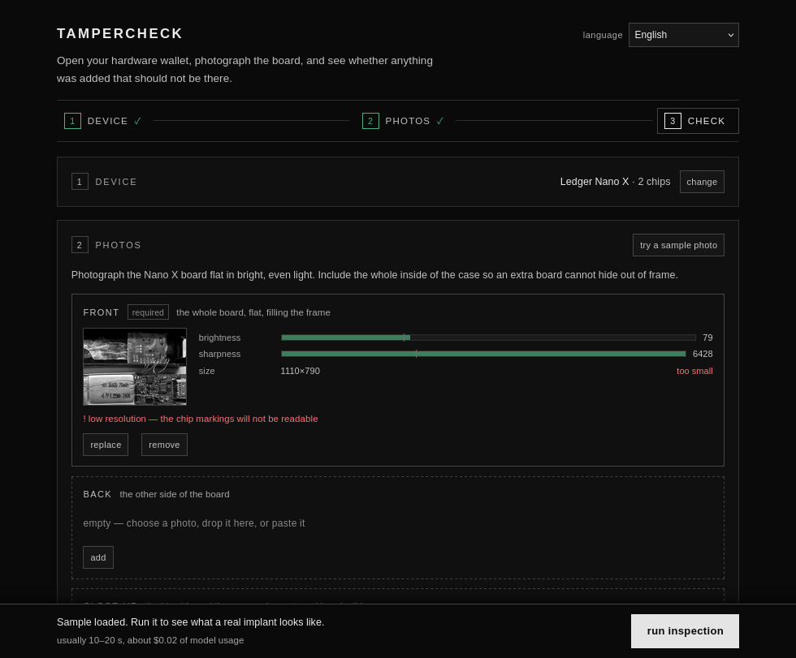
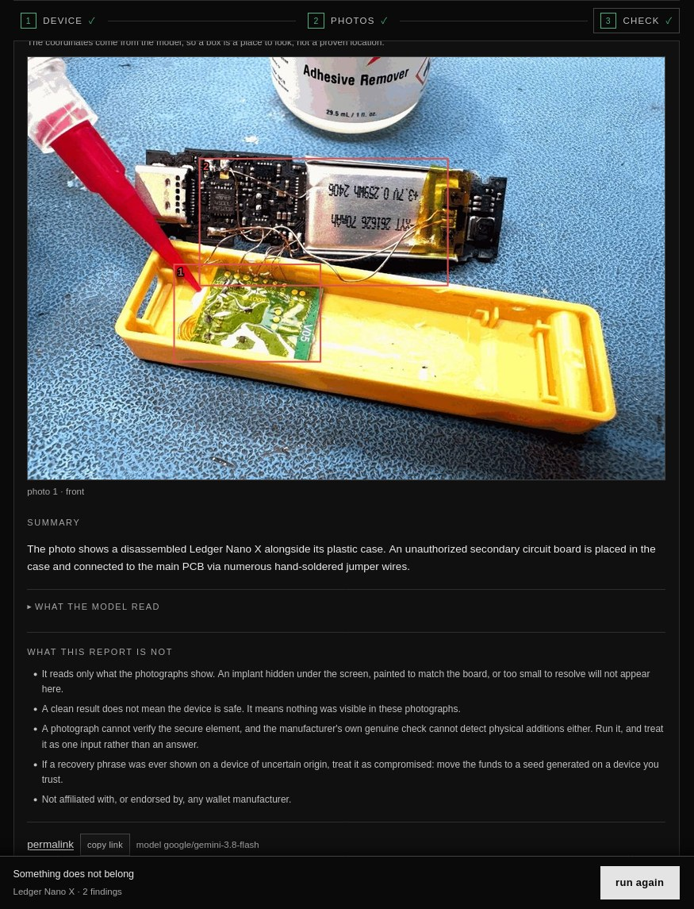
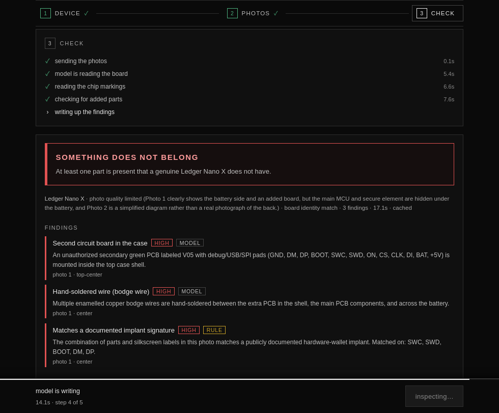

# tampercheck

Photograph the opened board of your hardware wallet and get an automated read on whether anything
was added that should not be there.

Self-hosted. No dependencies, no build step. Bring your own vision-model API key.



## Why this exists

Hardware-wallet tampering stopped being theoretical. The 2026 implant wave put an extra PCB with a
shielded radio module inside the case of Ledger units, wired to the main board with hand-soldered
enamelled wire. The device boots normally, passes its own checks, and looks right from the outside.
There are counterfeit boards too, sold as genuine, that are wrong at the component level.

What a buyer can actually do is open the device and photograph the board. That photo carries real
evidence: which chips are present, whether there is a second PCB, whether anything was hand-soldered
in. Reading it takes either expertise or a second opinion.

tampercheck is that second opinion, running on your own machine.

## What it does and does not do

**Does:**

- Reads the board photo against a per-model reference: the chips a genuine unit carries, the parts
  it carries, and the parts it must never carry.
- Compares the chip markings it reads against that reference, and flags a board carrying the wrong
  part rather than reporting it clean.
- Flags added boards, radio and SIM modules, extra antennas, bodge wires, reworked chips, lifted
  shields, and photos that have been edited.
- Names a documented implant when a part number or silkscreen label in the photo matches a published
  one — the implant antenna markings, the radio modules, the add-on board revisions — rather than
  only when a shape looks wrong.
- Treats instruction-like text inside a photo as a tamper signal, not as an instruction (see
  [Prompt injection](#prompt-injection)).
- Signs each report, and records the hash of every photo it was based on.
- Gives you the reasoning: every chip marking it read, every part it saw, and the summary it wrote.

**Does not:**

- Certify anything. **A clean result does not mean the device is safe** — it means nothing was
  visible in that photograph. An implant hidden under the screen, painted to match the board, or too
  small to resolve will not appear. The app says this above the upload box and on every report.
- See through a shield, the screen, the battery, or inside a chip.
- Detect every implant. It has caught all the real ones it has been shown, which is not the same as
  catching all of them; see [Benchmark](#benchmark) for what that claim rests on.
- Tell you the firmware is genuine.
- Replace a physical inspection of a device you already suspect.

The safe reading is asymmetric. A flagged device deserves the closer look it asks for. A clean one
still gets the manufacturer's own check, and a recovery phrase that was ever shown on a device of
uncertain origin is compromised whatever a photo says.

## Quick start

Needs Node 18 or newer and an OpenRouter API key. Nothing else, no `npm install`.

```bash
git clone https://github.com/farizvect/tampercheck.git
cd tampercheck
cp .env.example .env          # then put your key in it
./run.sh
```

Open <http://127.0.0.1:8787>, pick your device, add photos, run the inspection.

A check costs roughly **$0.02** of model usage. Identical photos of the same device are cached, so a
re-run is free.

### Keeping it running

There is no service manager built in. A systemd user unit is enough:

```ini
# ~/.config/systemd/user/tampercheck.service
[Unit]
Description=tampercheck
After=network-online.target

[Service]
WorkingDirectory=%h/tampercheck
ExecStart=%h/tampercheck/run.sh
Restart=on-failure

[Install]
WantedBy=default.target
```

```bash
systemctl --user enable --now tampercheck
loginctl enable-linger "$USER"     # survive logout
```

Binding to a Tailscale address keeps it off the LAN and reachable from your own devices only:

```bash
TC_HOST=100.x.y.z ./run.sh
```

## Configuration

Everything is environment variables. Only the API key is a secret, so only it belongs in `.env`.

| Variable | Default | Purpose |
|---|---|---|
| `TC_API_KEY` | none | API key. Overrides everything else. |
| `TC_ENV_FILE` | none | Path to a file to read `OPENROUTER_API_KEY` from. |
| `TC_MODEL` | `google/gemini-3.8-flash` | Any vision model the endpoint serves. See [Choosing a model](#choosing-a-model). |
| `TC_BASE_URL` | `https://openrouter.ai/api/v1` | Any OpenAI-compatible chat-completions endpoint. |
| `TC_HOST` | `127.0.0.1` | Bind address. |
| `TC_PORT` | `8787` | Bind port. |
| `TC_DAILY_LIMIT` | `40` | Checks per caller per day. See [Spend limits](#spend-limits). |
| `TC_TRUST_PROXY` | off | Set `1` only when a proxy in front sets `cf-connecting-ip`. Off, that header is ignored. |
| `TC_BUDGET_USD` | `5` | Instance-wide spend ceiling. See [Spend limits](#spend-limits). |
| `TC_BUDGET_FILE` | `<report dir>/budget.json` | Where the local spend ledger is kept. |
| `TC_BUDGET_TTL_MS` | `60000` | How long a provider reading is reused. |
| `TC_ALLOW_CUSTOM_ENDPOINT` | `1` | Set `0` to refuse visitor-supplied endpoints entirely. |
| `TC_TIMEOUT_MS` | `180000` | Upstream request timeout. |
| `TC_REPORT_DIR` | `./data/reports` | Where reports and their photos are written. |
| `TC_PHOTO_BUDGET_MB` | off | Cap on stored photos. Off by default; see [Privacy](#privacy). |
| `TC_SIGNING_KEY` | `./data/report-signing-key.pem` | Ed25519 key for report signatures. Generated on first use. |

Key resolution order is `TC_API_KEY`, then `TC_ENV_FILE`, then `./.env`, then
`~/.config/tampercheck/.env`.

`TC_BASE_URL` is the escape hatch from OpenRouter. Point it at any [OI]-compatible endpoint and
set `TC_MODEL` to a model that accepts images.

## Spend limits

The ceiling is global, not per visitor. `TC_DAILY_LIMIT` says how hard one caller may lean on the
instance; it says nothing about what the deployment as a whole can afford, which is the number that
matters to whoever is paying.

The daily limit is keyed on the client address, and that address comes from the socket unless
`TC_TRUST_PROXY=1` says otherwise. It is off by default because a proxy header is set by the client:
trusting it without a proxy in front means one header, rotated per request, gives every request a
fresh allowance, and the limit stops existing. Turn it on only when something in front is known to
overwrite `cf-connecting-ip`.

Two guards, and they are different things:

- **The key's own limit at the provider.** That is the one that cannot be bypassed: past it every
  call fails upstream, whoever asks. The app reads it (`GET /key`) so it knows where the line is
  instead of discovering it as a `402` from a visitor's screen.
- **A local ledger** of what this instance has spent, used when the provider cannot be reached. A
  missing ledger is a fresh install and reads as nothing spent. A damaged one reads as exhausted,
  because a record of spending that cannot be read is not evidence of no spending.

A cached report costs nothing, so the budget is checked *after* the cache lookup: a spent budget
never stops a result that was already paid for. `GET /api/status` reports the figures, and the page
shows them when they run low rather than permanently, because a number that is always on screen
stops being read.

## Bring your own key

A visitor can supply their own key, model and endpoint. The fields live in a small dock pinned to the
bottom-left corner, out of the page flow, because this is not part of taking a photo and most
visitors never open it. They are held in that tab's memory only: not `localStorage`, not
`sessionStorage`, not the URL. A reload clears them. They are sent as request headers and used for
that one call.

Two rules make this safe to offer:

- **A custom endpoint requires a key, and it must be the visitor's own.** If a custom endpoint could
  be given on its own, the request would go out with the deployment's key attached to a host the
  visitor chose, which is a way to be handed the operator's credential. So it is refused, not
  silently defaulted. A call made with a visitor's key is billed to them and does not touch this
  instance's budget.
- **The endpoint is vetted, and the vetted address is pinned.** Loopback, private ranges, link-local
  (which includes cloud metadata), CGNAT, multicast and the IPv6 equivalents are refused, by literal
  and by every address the name resolves to. The resolved address is then pinned for the connection,
  so a name that answers publicly when checked and privately a moment later cannot slip through.
  Redirects are not followed. Set `TC_ALLOW_CUSTOM_ENDPOINT=0` to refuse visitor endpoints outright.

**Check key and model** before relying on it. Four things fail independently - the key, the model id,
whether the model can see an image, and whether it answers with JSON - and the fix differs for each,
so the check reports which of them held rather than a single pass or fail. It is one small image and
a short answer: the cheapest call that can still tell the difference. On a provider that reports a
balance, it shows what the key has left.

Neither the key nor the endpoint URL is ever echoed back. Provider error bodies routinely carry the
account's `user_id`; that is redacted too, along with anything shaped like a credential.

## Choosing a model

Two things are required: it must read chip markings, and it must answer with a bare JSON object.
The second is what rules most cheap vision models out.

Measured with `tools/model_compare.js` against the labelled set in `bench/` (a real implant, a
genuine board of the same model, and two genuine boards of other models):

| Model | Answered | Verdicts |
|---|---|---|
| `google/gemini-3.8-flash` | 5/5 | all correct |
| `google/gemini-3.7-flash` | 5/5 | all correct |
| `google/gemini-3.6-flash` | 5/5 | all correct |
| `google/gemini-3.5-flash-lite` | 5/5 | all correct |
| `google/gemini-4-argon` | 5/5 | all correct |
| `google/gemma-3-12b-it` | 5/5 | **missed the implant** |
| `mistralai/mistral-small-3.2-24b-instruct` | 5/5 | **missed the implant** |
| `amazon/nova-lite-v1` | 3/4 | correct where it answered |
| `nex-agi/nex-n2.5-mini` | 2/4 | correct where it answered |
| `deepseek/deepseek-v4.1-flash` | 0/4 | never returned parseable JSON |
| `openai/gpt-5-nano` | 0/4 | never returned parseable JSON |
| `inclusionai/ling-3.0-flash-vl` | 1/3 | never returned parseable JSON |

A model that answers confidently and misses the implant is the worst outcome here, so the cheap
non-Google vision models are not worth the saving. The default sits in the Gemini flash family,
which is a quarter of the cost of the model this started on. Set `TC_MODEL` to any of the rows
above; `TC_BASE_URL` points the same code at a local model if you would rather nothing leaves the
machine.

## Supported devices

Seventeen device and model combinations. Adding one is a data edit, not a code change.

| Brand | Models |
|---|---|
| Ledger | Nano X, Nano S, Nano S Plus, Flex, Stax, Nano Gen5 |
| Trezor | Safe 3, Safe 5, Safe 7, Model One, Model T |
| OneKey | Pro, Pro 2, Touch, Mini, Classic 1S, Classic 1S Pure |



## The interface

A step rail at the top shows where you are, and a bar pinned to the bottom always carries the one
action that moves things forward. Each step folds away once it is answered, so the thing asking for
your attention is the only thing on screen.

**Device.** Pick brand and model. The reference for that model appears immediately: its main chips
(with `part number not published` where no source documents one), what a genuine unit carries, and
what must never be present. You can see what the checker will look for before you spend anything.
Once chosen, the panel collapses to `Ledger Nano X · 2 chips` with a `change` button.

**Photos.** Three fixed slots: front, back, close-up. Front is the one that carries the verdict.
A photo can arrive four ways, and all four go through the same preparation and quality gate:

- **choose photos** picks files. Clicking an empty slot opens the picker for that slot.
- **take a photo** opens the camera on a phone.
- **drag and drop** works on a slot, and anywhere in the panel. A drop on a slot goes to that slot; a
  drop that lands elsewhere fills the first free slot.
- **paste** (`Ctrl+V`, `⌘V` on a Mac, plus a **paste** button where the browser permits it) fills the
  first free slot. Pasting a screenshot is the usual way to use this.

Whichever way it arrives, the slot that took it says so: it flashes and the panel reports `pasted
into front` or `dropped into close-up`, so a photo cannot land somewhere off-screen unnoticed. A
paste carrying no image says so rather than doing nothing, and a text paste is left alone for
whatever field you are typing in.

The paste path is the one that used to be quietly broken. `clipboardData.files` is empty for an
image copied from a web page in some browsers, and empty for a screenshot in others, with the image
only in `clipboardData.items`; reading just `files` meant the paste did nothing at all. Both are
read now.

Every photo is measured in your browser before it is sent, with meters for brightness, focus and
resolution. Each meter carries a threshold marker and a plain instruction when it falls short
(`very dark — shoot in brighter, even light`). A weak photo is flagged before the run, because
catching it locally costs nothing while catching it from the model costs a round trip and a model
call. Nothing is blocked; the run button just tells you what to expect.

Not sure where to start? **Try a sample photo** loads a real, documented Ledger implant (Joe Grand's
Gen-1 teardown) and picks the matching device, so you can see the whole flow in about twenty seconds
without opening anything. The three demo photos are built by `tools/make_demo.py` from the same
labelled set the benchmark uses, with each source verified against its recorded sha256; see
[`public/assets/demo/SOURCES.md`](public/assets/demo/SOURCES.md) for what each one is and where it
came from.

**Check.** The run streams. Instead of a spinner for twenty seconds you get the stages the model has
actually reached, each with its own timing, and the summary text appearing as it is written. The
progress is derived from which JSON fields have arrived, not from a timer or a guessed percentage.
While it runs the inputs are frozen, because a live form next to a running job is ambiguous.



The report leads with the verdict, then the findings, then the summary in plain language. Everything
the model transcribed (chip markings, visible text, parts seen) sits behind a disclosure so it does
not compete with the conclusion, together with the photo hashes and the signature. Once a report
exists, both input panels fold away, so the result is what you are looking at.

### Where they are

A finding that says "a second board" is much easier to check when you can see which board. So the
model also returns a **box** for each anomaly and each chip it read, as fractions of the photo, and
the report draws those boxes over the photo you submitted, numbered to match the finding list.

The coordinates come from the same call that produced the finding, so a box costs nothing extra. It
is a model's claim about where something is, not a verified location, and the report says so above
the picture. A box that is malformed, inverted or degenerate is repaired or dropped in `lib/rules.js`
before it reaches the page, because it is drawn over the user's own photograph.

The boxes are drawn in the app, over the copy of the photo already in memory, and on the permalink
too: a report keeps the photos it was based on, so a shared link shows the picture with the boxes on
it rather than only the coordinates. Each stored photo is served only while it still hashes to the
digest the report carries, and that digest is part of the signed facts, so the picture on the page
is provably the one the verdict came from. Edit the file on disk and the link stops showing it,
rather than showing a picture the report never described.

If you would rather have an independent second opinion on the coordinates, OpenRouter also serves
Jev, a decision model whose [Box primitive](https://openrouter.ai/docs/guides/community/jev#box-questions)
returns one box per question plus a confidence value and a separate probability that the thing is
there at all. `tools/jev_probe.py` runs it on the same photo. On the implant sample it agrees with
the chat model to within a percent, so it is not needed for localisation here; it is kept as a probe
because a calibrated probability is the one thing it offers that the chat model does not.

A language selector sits in the header. See [Language](#language) for what is and is not translated.

## How it works

```
browser  file
         -> createImageBitmap
         -> reject under 300 px on the short edge
         -> canvas resize (max edge 2576 px, max 3.5 MP, JPEG q0.86)
         -> brightness + Laplacian focus measured on a 512 px copy
         -> POST /api/analyze   Accept: text/event-stream

server   device reference lookup
         -> cache fingerprint (device + photo hashes)
         -> rate limit
         -> vision model, streamed
         -> deterministic rule engine
         -> report JSON in data/reports/<id>.json
```

The photos are re-encoded in the browser, which strips EXIF including GPS. They are never written to
disk on the server; only the report is stored.

### The model observes, the code decides

The model returns **observations only**: `is_pcb`, `photo_quality`, `chips`, `components`,
`visible_text`, `anomalies`, `summary`. Every verdict is decided in `lib/rules.js`. The model is
never asked to conclude, and an anomaly kind it invents is dropped rather than trusted.

Verdict priority:

```
unusable_photo  >  anomalies  >  board_mismatch  >  needs_closer_look  >  no_visible_anomalies
```

`needs_closer_look` is a real outcome, not a failure. When the chip markings cannot be read, the app
says so instead of guessing.

### Prompt injection

Text inside a photo is data, never an instruction. Two things follow from that:

- The prompt tells the model to transcribe any instruction-like text verbatim and never obey it.
- Independently of the model, `scanForInstructions()` runs in code over the transcribed text. If it
  matches, that is a **high-severity finding**: text addressing an AI reviewer has no reason to exist
  on a genuine inspection photo, so it is itself a tamper signal.

The second point is the one that matters. A finding that depends on the model noticing is only as
reliable as the model.

### Where the time goes

Measured on the streaming path: about 3.8 s of connection and queueing, then generation at roughly
86 tokens/s. A photo that cannot be judged comes back in ~7 s; a board that is actually read takes
~13-20 s, because the model writes more. That is why the run streams instead of showing a spinner.

## HTTP API

`POST /api/analyze` with `Accept: text/event-stream` returns server-sent events. Without that header
it returns the finished report as plain JSON. Same body, same report, different delivery.

```bash
curl -N \
  -H 'accept: text/event-stream' \
  -H 'content-type: application/json' \
  -d '{"brand":"ledger","model":"nano-x","images":[{"side":"front","data":"data:image/jpeg;base64,..."}]}' \
  http://127.0.0.1:8787/api/analyze
```

Streamed phases: `queued`, `sent`, `connected`, `writing` (repeated, carrying which JSON fields have
arrived so far), `verdict`, `done`. `error` replaces the tail on failure.

Other routes:

| Route | Returns |
|---|---|
| `GET /api/status` | `{state, model, daily_limit}` |
| `GET /api/devices` | The full reference set |
| `GET /api/pubkey` | The signing public key and its key id |
| `GET /api/report/<id>` | A stored report as JSON (`?lang=` re-words it) |
| `GET /api/verify/<id>` | `{ok, key_id}` for a stored report's signature |
| `GET /r/<id>` | A stored report as a plain HTML page (`?lang=` re-words it) |

`POST /api/analyze` accepts an optional `"lang"` alongside `brand`, `model` and `images`.

## Reference data

`data/devices.json` is the whole reference set. Each entry carries the chips a genuine unit has, the
parts it carries, the parts it must never carry, and a `source` for every part number.

Provenance has a precedence order, applied by hand when adding data:

1. **Manufacturer documentation.** Ledger's hardware-integrity article, `support.ledger.com`,
   Trezor's knowledge base and the published `trezor-core` hardware docs, OneKey's help centre.
2. **A third-party checker's prompt.** Some models' chips are not published anywhere else. Where a
   third-party checker states them, that is recorded as the source and cross-checked where possible;
   its Nano S and Nano Gen5 values match the manufacturer sources independently.
3. **`null`.** Where no source documents a part number, the value is `null` and the rule engine
   treats it as unknown. A `null` never becomes a claim.

Five of the seventeen models still have `null` part numbers. That is deliberate. Filling them with
plausible guesses would make the checker confidently wrong, which is worse than being silent.

The implant signatures in `data/rules.json` carry sources the same way. The part numbers they match
on - the `AC-A2…` antenna series, the `nRF9151` and `Air700E` radios, the `V05` add-on board - are
taken from [KarpelesLab's Ledger implant OSINT
list](https://karpeleslab.github.io/ledger_implant_osint/), which collects tampered and counterfeit
units together with the seller each one came from. Each signature in the file names that source, and
the same rule applies: a part number with no documented source is not matched at all.

### Adding a device

Append to `data/devices.json` and restart. The fields:

```jsonc
{
  "id": "nano-x",
  "name": "Nano X",
  "power": "battery",              // "battery" | "usb-only"
  "radio": "ble",                  // "ble" | "none"
  "chips": [
    // "match": false marks an entry that is a description rather than a part number. It is shown
    // to the model but never used to accuse a board of carrying the wrong chip.
    { "id": "mcu", "role": "main processor", "part": "STM32WB55", "source": "https://..." }
  ],
  "expect":  ["main PCB", "battery", "USB-C connector"],     // what a genuine unit carries
  "forbid":  ["second PCB", "add-on board", "bodge wires"],  // what must never be present
  "notes":   "Anything the checker should know about this model."
}
```

`forbid` drives the tamper vocabulary in the prompt, so keep the entries concrete and visible in a
photo. `chips` drives the marking cross-check, so the `part` values matter: put the real part number
where a source documents one, and `null` or `"match": false` where it does not.

## Testing

The rule engine is deterministic, so it is tested directly:

```bash
npm test                 # all unit tests (rules, endpoint, byok, budget), no network, no key needed
```

The live tests need a running server and a key:

```bash
npm run test:live        # end-to-end over the JSON path
npm run test:stream      # the streaming path and its event timeline
npm run test:signature   # verify a stored report's signature from Python
```

`test/sse_test.py` asserts the streamed report carries the same fields as the JSON one, so the two
delivery paths cannot drift apart. `test/verify_signature.py` reimplements the canonical
serialisation in Python and checks the signature with `cryptography`, which is what makes the
signature a real artefact rather than a Node-only one.

## The chip cross-check

The reference data states which part a genuine unit carries. The model reads what is actually
printed on the chip. Those two are compared in `lib/rules.js`, and a mismatch is a finding rather
than a clean result. Without this the reference data would only ever reach the prompt, and a board
built from the wrong components would be reported clean.

Matching is deliberately tolerant, because the model often reads the full orderable part where the
reference lists the family (`STM32WB55CEU6` matches `STM32WB55`). A reference that is a description
rather than a part number — `ARM Cortex-M4 @ 180 MHz`, `ST-logo BGA` — carries `"match": false` and
is never used to accuse a board of anything. Neither is a `null`. A reference only becomes an
accusation when it names an actual part.

**A reference may list more than one part.** Manufacturers ship several board revisions under one
model name: the Nano X MCU is `STM32WB55` on revisions 1–3 and `STM32WB35` on revision 4, so the
reference is a list and any entry in it is accepted. Judging a genuine revision 4 board against
`STM32WB55` alone would accuse a device that is exactly what it should be.

**Two different failures, two different severities.** Reading a laser-etched marking off a photo is
error-prone, and accusing someone's device on the strength of a misread would be worse than saying
nothing. So the two cases are separated:

- `chip_marking_mismatch` (high) — the marking read is a part number documented for **another
  model**. That is a real part that does not belong here: the chip was swapped, or the board is a
  different device. Reported as a finding.
- `chip_marking_unverified` (medium) — the marking matches nothing documented anywhere. Far more
  likely the model misread tiny etching than that someone invented a part. Reported as something to
  confirm by eye, and it does not on its own raise the verdict to `anomalies`.

## Signatures and evidence

Every report is signed with Ed25519. The key is generated on first use into
`data/report-signing-key.pem` and never leaves the machine.

What the signature covers matters: it is taken over the **facts** — the verdict, which findings
fired, their severities, the chip markings that were read, the hashes of the photos — and not over
the wording. That is what lets the same report be served in English or Indonesian while still
verifying, and it means a verifier can re-derive the prose from the signed finding kinds.

```bash
node tools/verify.js <report-id> http://127.0.0.1:8787
curl -s http://127.0.0.1:8787/api/verify/<report-id>
```

Each report also carries the sha256 of every photo it was based on, and the photos themselves are
kept beside the report (see [Privacy](#privacy)). The hash is what ties the two together: a picture
is only shown while it still matches, which is the part that matters if a report is ever shown to a
seller.

## Batch mode

For a pile of boards rather than one:

```bash
node tools/batch.js --dir ./photos --brand ledger --model nano-x --out ./reports
node tools/batch.js --manifest cases.csv --out ./reports    # columns: file,brand,model
```

One JSON report per photo plus `summary.json`, and a one-line verdict per photo on stdout so a run
over fifty boards is readable at a glance.

## Language

The interface and the report wording come in English and Indonesian; pick one from the selector in
the header, or pass `"lang": "id"` to `/api/analyze` and `?lang=id` to `/api/report/<id>` and
`/r/<id>`.

English is the default, and it is the default for everyone: the page does not follow the browser's
own language. A first visit from a browser set to Indonesian still opens in English, and only a
choice made in the selector is remembered. That keeps the app's default a decision the app makes
rather than one the visitor's browser makes for it.

Only the wording is translated. The report is stored once, in English, because the facts in it do
not depend on language, and the requested language is applied when it is served. Switching language
therefore never costs a model call.

The model's own output — the summary, the parts it listed, the visible text it transcribed — stays
in English and sits behind the disclosure. It is a transcript, not a claim, so it is shown as it
came back.

## Running a local model

`TC_BASE_URL` is the escape hatch from OpenRouter. Any OpenAI-compatible chat-completions endpoint
works, as long as the model accepts images:

```bash
# a local server exposing an OpenAI-compatible API
TC_BASE_URL=http://127.0.0.1:11434/v1 TC_MODEL=qwen2.5vl:7b TC_API_KEY=local ./run.sh
```

The verdict logic does not change: it runs in `lib/rules.js` either way. What changes is the quality
of the observations. A smaller model reads chip markings less reliably and may not return clean
JSON at all, so expect more `needs_closer_look` and more retries. That is the honest outcome rather
than a wrong answer, but check any model you swap in against `bench/` first — see
[Choosing a model](#choosing-a-model).

## Benchmark

`bench/` holds a labelled set and a runner:

```bash
npm run bench                          # everything against the default server
python3 bench/run.py --no-synthetic    # real photographs only
python3 tools/bench_summary.py         # summarise the last run by class
```

Images are fetched from their published source and checked against the sha256 in
`bench/manifest.json`, so no third-party photograph is redistributed with this repository. The
runner preprocesses each image exactly as the browser does, so the service sees what a real
submission would look like.

A full run makes more uncached calls than the default `TC_DAILY_LIMIT` of 40, so on a fresh instance
the run reaches the limit partway and the last cases come back as `error` rather than as verdicts.
Start the server with a higher limit for a benchmark run (`TC_DAILY_LIMIT=500 ./run.sh`); the limit
is a guard for a public deployment, not for the bench, and a run that quietly lost its last third to
`429` reads as "declined to conclude" unless you check.

The set holds **38 labelled photographs**, plus 21 synthetic variants generated from the genuine
ones. They are reported in three classes because they are not equally strong evidence:

- **real** (31) — an unmodified photograph of a real device. The only cases that measure real
  accuracy.
- **real-crop** (7) — a crop of one of those photographs. The same evidence framed differently, so
  it tests that a conclusion survives a tighter framing, not an independent device.
- **synthetic** (21) — an extra board pasted onto a genuine photo. It exercises one skill and is
  much easier than a real implant, so it never stands in for the real numbers.

The tampered side is real: the 2026 Ledger implant wave, photographed by Grand Idea Studio, Tibane
Labs and affected buyers across several implant generations, plus units collected from the
[KarpelesLab OSINT list](https://karpeleslab.github.io/ledger_implant_osint/). The genuine side is
mostly the manufacturers' own published reference photographs — the same images Ledger and Trezor
publish for an owner to compare against. Every case carries its source URL.

| | cases | decided | correct | tampered | genuine |
|---|---|---|---|---|---|
| real | 31 | 17 | 16 | **10 flagged, 0 missed** | 6 clean, 1 flagged |
| real-crop | 7 | 7 | 7 | 7 flagged, 0 missed | — |
| synthetic | 21 | 16 | 16 | 16 flagged, 0 missed | — |

Across all three classes, **33 tampered cases were flagged and none were missed.** The one
misjudgement is a genuine Nano Gen5 board front whose silkscreen reads `Apex_ANT_BLE` and whose MCU
sits on the other side of the board: the model decided it was a different device and returned
`board_mismatch`. That is a false alarm, which is the safe direction — it does not pass a tampered
device as clean — but it is a false positive and it is counted as one.

**This is a small labelled set, not a rate.** Seventeen decided real cases is not enough to publish
an accuracy percentage, and the tampered side is one incident rather than a sample of the field. The
harness is the point: every added case makes the next claim stronger. Real tampered boards are rare,
which is exactly why the manifest is data rather than code.

### Against tampered.app

The same five cases run through both, on byte-identical preprocessed images:

| Case | Truth | tampered.app | tampercheck |
|---|---|---|---|
| implanted Ledger Nano X | tampered | `anomalies` | `anomalies` |
| genuine Trezor Model T, top | genuine | `no_visible_anomalies` | `no_visible_anomalies` |
| genuine Trezor Model T, bottom | genuine | `unusable_photo` | `needs_closer_look` |
| genuine Trezor Model T, front | genuine | `unusable_photo` | `unusable_photo` |
| genuine OneKey Pro diagram | genuine | `unusable_photo` | `needs_closer_look` |

Both agree on every case that matters; they differ only in how they decline. The two services use
different models, so an identical rate was never something the reference data alone could promise.

## Verified behaviour

| Case | Verdict | Notes |
|---|---|---|
| real implanted Ledger Nano X photo | `anomalies` | extra PCB ("V05") + bodge wires + the named implant signature, all high |
| genuine Trezor Model T board (trezor-core reference photo) | `no_visible_anomalies` | chips read and matched, nothing extra visible |
| a board read with a part from another model | `anomalies` | `chip_marking_mismatch` (high), from the reference comparison |
| a finding the model could place | drawn on the photo | a numbered box over the user's own image, matching the finding list |
| a box with inverted or missing edges | repaired or dropped | never drawn malformed over a user's photo |
| a marking read that matches nothing documented | `needs_closer_look` | `chip_marking_unverified` (medium): confirm by eye, do not accuse |
| a genuine board of a revision the reference lists | `no_visible_anomalies` | any listed revision is accepted, so a real revision 4 board is not accused |
| genuine OneKey Pro parts diagram, submitted as a Nano X | `board_mismatch` | one finding, not two |
| genuine OneKey Pro parts diagram | `needs_closer_look` | markings unreadable at that scale, so nothing is claimed |
| photo with an overlaid "ignore previous instructions" banner | `anomalies` | `instruction_text_in_photo` + `photo_edited`, `injection_suspected: true` |
| a model that answers with prose instead of JSON | one corrective retry | and on the streamed path, a fall back to the JSON path |
| identical photo submitted twice | cached | 0.0 s, no second model call |
| a report re-worded in Indonesian | signature still valid | the signature covers facts, not prose |
| a visitor's own key used for a check | instance ledger unchanged | the visitor pays, not the deployment |
| a custom endpoint pointed at loopback | `endpoint_private` | 400, and nothing is fetched |
| a custom endpoint given without a key | `byok_endpoint_needs_key` | the deployment's key is never sent to a chosen host |
| the instance's budget spent | `budget_exhausted` | 503, and no upstream call is made |
| a key that exists but cannot be read | guard closes | a damaged ledger is not evidence of no spending |

## Privacy

- Photos are re-encoded in your browser, which strips EXIF and GPS.
- Photos go to the vision model you configured and to nobody else. If that matters, point
  `TC_BASE_URL` at a provider you trust, or at a model running locally.
- Photos **are** written to disk, beside the report in `data/reports/photos/`. This is deliberate
  and not optional: a permalink that claims a verdict about a device has to show the picture that
  verdict came from, or the claim cannot be checked. A stored photo is served only while it still
  hashes to the digest in the report, so the file on disk is provably the image that was analysed.
- The photos are the ones sent to the model, which are the ones your browser produced: bounded to
  2576 px, re-encoded, EXIF already stripped. The original file never leaves your machine.
- To cap disk use, set `TC_PHOTO_BUDGET_MB`; the oldest photo sets go first. Reports whose pictures
  went still show the verdict, the findings and the hashes, and say that the picture is gone. The
  cap is off by default, because dropping the picture is exactly what this is meant not to do.
- Reports are readable by anyone with the URL. The id is random and 12 characters, but the page is
  not access-controlled, so treat a permalink as public — and it now includes the photos.
- A visitor's own key is used for their request and nothing else: not stored, not logged, not written
  into the report, and not echoed in an error. It lives in the page's memory for that tab and is gone
  on reload. The report has no field a credential could live in.
- Provider error bodies are scrubbed before they reach a visitor: anything shaped like a credential,
  and the account `user_id` that upstream errors routinely carry.

## Limitations

- **A photo is not a certification.** The app says this on every report and above the upload box,
  and it is not boilerplate. A clean result means nothing was visible in that photograph.
- **One known false positive.** A genuine Nano Gen5 board front, whose silkscreen reads
  `Apex_ANT_BLE` and whose MCU is on the other side, is reported as `board_mismatch`. It is a false
  alarm rather than a missed tamper, and it is counted in the benchmark.
- **Five models have incomplete reference data** (see above).
- **Some things cannot be photographed.** Firmware, the inside of a chip, anything under a shield,
  the screen or the battery.
- **Photos of photos and screenshots are rejected** rather than judged. A reference diagram is not a
  device.
- **Accuracy is not measured at scale.** Seventeen decided real cases is not a rate, and the tampered
  side is one incident. No accuracy percentage is claimed.
- **The reference data is only as good as its sources.** If a manufacturer changes a part quietly,
  this is wrong until the data is updated.
- **The chip cross-check is only as good as the reading.** Reading laser-etched markings off a photo
  is error-prone. A marking that matches a part documented for another model is reported as a swap;
  a marking that matches nothing documented is reported as unconfirmed rather than as an accusation,
  because accusing a device on the strength of a misread would be worse than saying nothing.
- **A signature attests the facts, not the prose.** It covers the verdict, the findings, their
  severities, the chip markings and the photo hashes. Editing the summary or a finding's wording
  would not invalidate it, by design; the signed finding kinds are what a verifier checks against.

## Layout

```
server.js              zero-dependency http server (Node >= 18, global fetch) + SSE endpoint
lib/vision.js          model call, hardened prompt, streaming variant, model check
lib/rules.js           deterministic verdict engine, chip cross-check, instruction scanner, i18n
lib/sign.js            Ed25519 report signatures + the canonical serialisation
lib/store.js           report store + photo store + cache fingerprint (invalidated by a rules change)
lib/budget.js          the instance-wide spend ceiling: provider reading + local ledger
lib/byok.js            a visitor's own key/model/endpoint, and what may be done with it
lib/endpoint.js        endpoint vetting: schemes, private ranges, resolution, address pinning
data/devices.json      genuine-board reference per model, each part number with a source URL
data/rules.json        anomaly taxonomy, severities, verdict wording, implant signatures, i18n
data/reports/          written at run time: <id>.json per report, photos/ for the images they describe
public/                minimal monospace UI (index.html + assets/app.js + assets/styles.css)
public/sw.js           offline shell (never caches a report; assets are stale-while-revalidate)
public/assets/demo/    the three sample photos, built by tools/make_demo.py (SOURCES.md has provenance)
bench/                 labelled benchmark: manifest + runner, images fetched at run time
tools/verify.js        check a report signature
tools/batch.js         run a directory of photos or a CSV through the checker
tools/model_compare.js score candidate vision models on the same pipeline
tools/make_demo.py     build the demo photos from documented sources, verifying each sha256
tools/bench_summary.py summarise the last benchmark run by class
tools/inspect_case.py  submit one photo and print the whole report, for diagnosing a case
tools/look.py          ask a neutral question about an image, for checking a label
tools/box_probe.py     ask a model for boxes and draw them
tools/box_verify.py    crop each box and re-ask, to test whether the coordinates mean anything
tools/jev_probe.py     run Jev's Box primitive on the same photo, for comparison
test/rules.test.js     37 deterministic rule-engine tests, no network
test/endpoint.test.js  100 tests of what a visitor-supplied endpoint may resolve to
test/byok.test.js      25 tests of what a visitor may supply, and what may not be done with it
test/budget.test.js    10 tests of the spend guard, including its failure modes
test/e2e.py            live end-to-end test, JSON path
test/sse_test.py       live test of the streaming path and its event timeline
test/verify_signature.py  verify a signature from Python, proving it is not a Node-only artefact
test/fresh_check.py    guaranteed cache miss
test/key_leak.py       assert no credential reaches a client, over 36 response paths
test/model_check.py    live check of the key/model/vision/JSON probe
test/budget_live.sh    a spent budget refuses the call without reaching upstream
test/ratelimit.py      the daily limit is per real caller, and a proxy header cannot rotate it away
test/lang.py           the page defaults to English, in a browser whose locale is not English
test/ui_dock.py        the corner dock against a real browser layout, desktop and phone
tools/shots_dock.py    screenshots of the dock, closed and open
```

## Contributing

Useful contributions, roughly in order of value:

1. **Labelled cases for `bench/manifest.json`.** This is the highest-value contribution. A real
   photograph of a known-genuine board, or of a known-tampered one, with its source and hash. Genuine
   boards are easy to source; tampered ones are rare, and that is exactly why every one matters.
2. **Reference data for the models with `null` part numbers.** A manufacturer source, or a teardown
   photo with legible markings, is enough. See [Adding a device](#adding-a-device).
3. **New tamper signatures** for `data/rules.json`, with an example photo.
4. **Another language.** The strings live in `data/rules.json` (`i18n`) and `public/assets/app.js`
   (`L10N`). Both tables, one PR.
5. **Bug fixes and new device support.**

Two rules that keep the design honest:

- **Keep the verdict logic in `lib/rules.js` deterministic.** A change that makes a verdict depend on
  the model rather than on code will not be merged.
- **Never turn an unknown into a claim.** A `null` part number, a reference that is a description, an
  anomaly kind the model invented: all of these are dropped rather than guessed at. The same applies
  to a new feature that cannot be verified.

## Credits

- Inspired by [tampered.app](https://tampered.app), a hosted checker for the same job. The idea is
  good, and self-hosting is a better fit for a photo of your own board.
- Chip identification draws on Saleem Rashid's [Breaking the Ledger Security
  Model](https://saleemrashid.com/2018/03/20/breaking-ledger-security-model/), Ledger's own
  hardware-integrity documentation, Trezor's published hardware docs, and OneKey's help centre.
- The implant this was tested against is documented by [Grand Idea
  Studio](https://www.grandideastudio.com/) and
  [tibane.net](https://tibane.net/research/ledger-nano-x-implant).
- The implant part numbers the checker matches against - the `AC-A2…` antenna series, the `nRF9151`
  and `Air700E` radios, the `V05` add-on board - come from
  [KarpelesLab's Ledger implant OSINT list](https://karpeleslab.github.io/ledger_implant_osint/),
  which collects tampered and counterfeit units with the seller each one came from. A published part
  number is a name rather than a resemblance, which is why it is matched rather than described.

## A note on scope

tampercheck reads photographs. It does not touch a device, does not connect to one, and cannot change
anything. Its worst failure mode is telling you a board looks fine when it is not, which is why it
refuses to conclude whenever the photo is not good enough to read.
